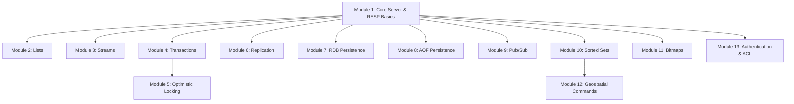

# Build Your Own Redis: Engineering Curriculum & Milestone Roadmap

Welcome to the **Build Your Own Redis** engineering journey. In this project, you will build an in-memory, key-value data store from scratch—from bare-metal TCP socket handling and protocol deserialization to concurrent connection multiplexing, transactions, replication, and distributed persistence.

As your mentor, I will not write the solutions for you. Instead, this roadmap breaks down every milestone into incremental, testable stages—modeled precisely on the Codecrafters curriculum—accompanied by the underlying Computer Science theory, Socratic inquiry questions, and design considerations.

---

## Pedagogical Workflow & Rules of Engagement

1. **One Concept, One Stage**: Do not rush ahead. Implement each stage incrementally, test it with standard client tools (`redis-cli`, `nc`, or automated unit tests), and verify edge cases.
2. **First-Principles Understanding**: We treat libraries as abstractions. Understand what happens at the POSIX/OS socket layer, how buffers store byte streams, and how serialization formats are parsed.
3. **Socratic Guidance**: When you encounter bugs or architectural dilemmas, present your observation, hypothesis, and debugging logs. I will ask probing questions to guide you toward the solution.

---



---

## Module 1: Core Server & Stages (Basics)

Focuses on low-level networking, the Redis Serialization Protocol (RESP), concurrent I/O, basic key-value storage, and time-to-live (TTL) mechanics.

| Stage | Name | Difficulty | Core Concept |
|---|---|---|---|
| 1.1 | **Bind to a port** | Very Easy | TCP Socket creation, `SO_REUSEADDR`, binding to `6379`, listening backlog. |
| 1.2 | **Respond to PING** | Easy | Socket accept loop, RESP Simple String format (`+PONG\r\n`). |
| 1.3 | **Respond to multiple PINGs** | Easy | Persistent TCP connections, loop over socket reads until EOF / disconnect. |
| 1.4 | **Handle concurrent clients** | Medium | Concurrency model: Multithreading, Threadpool, or Asynchronous I/O Event Loop (`select`/`poll`/`epoll`). |
TODO | 1.5 | **Implement the ECHO command** | Medium | RESP Arrays (`*<len>\r\n`) and Bulk Strings (`$<len>\r\n<data>\r\n`) parsing. |
| 1.6 | **Implement the SET & GET commands** | Medium | In-memory key-value dictionary/hash table, thread safety, parsing command arguments. |
| 1.7 | **Expiry** | Medium | Active vs. passive TTL expiration, epoch timestamps in milliseconds (`PX`), time monotonic clocks. |

> [!TIP]
> **Socratic Checkpoint (Module 1):**
> - When reading from a TCP socket, why is it dangerous to assume a single `read()` call receives exactly one complete Redis command? What happens when TCP segments are fragmented or coalesced?
> - How does Redis achieve high performance despite being historically single-threaded? What are the tradeoffs between a multi-threaded server and an event-loop-driven server for this project?

---

## Module 2: Lists

Covers the List abstract data type (ADT), ordered sequences, positive/negative index slicing, and non-polling blocking operations.

| Stage | Name | Difficulty | Core Concept |
|---|---|---|---|
| 2.1 | **Create a list** | Easy | Dynamically initialized doubly-linked list or dynamic array buffer per key. |
| 2.2 | **Append an element** | Easy | `RPUSH` operation on single element; handling new vs. existing keys. |
| 2.3 | **Append multiple elements** | Easy | Variadic argument processing; pushing elements sequentially to the tail. |
| 2.4 | **List elements (positive indexes)** | Easy | `LRANGE` with 0-based start and stop indexing. |
| 2.5 | **List elements (negative indexes)** | Easy | Python-style wrap-around offsets (`-1` as last element); boundary clamping. |
| 2.6 | **Prepend elements** | Easy | `LPUSH` command; inserting at the head of the list. |
| 2.7 | **Query list length** | Easy | `LLEN` command; $O(1)$ size tracking. |
| 2.8 | **Remove an element** | Easy | `LPOP` / `RPOP` command; returning Bulk String or Null Bulk String (`$-1\r\n`). |
| 2.9 | **Remove multiple elements** | Easy | Variadic `LPOP [count]`; batch popping and returning RESP Array. |
| 2.10 | **Blocking retrieval** | Medium | `BLPOP` / `BRPOP`; parking a client connection without burning CPU cycles until an element arrives. |
| 2.11 | **Blocking retrieval with timeout** | Medium | Scheduled waking or monotonic timeout tracking; unblocking on timeout expiration with `nil`. |

> [!TIP]
> **Socratic Checkpoint (Module 2):**
> - When multiple clients execute `BLPOP key 0` on an empty list, in what order should they be served when a subsequent `RPUSH key val` is received?
> - What synchronization primitive or event-loop notification mechanism prevents race conditions when unblocking a waiter?

---

## Module 3: Streams

Implements append-only log structures, millisecond and sequence ID validation, time-range querying, and fan-out consumer group primitives.

| Stage | Name | Difficulty | Core Concept |
|---|---|---|---|
| 3.1 | **The TYPE command** | Easy | Object metadata header (`string`, `list`, `stream`, `none`). |
| 3.2 | **Create a stream** | Medium | `XADD` basic layout; Radix tree or ordered map of entries. |
| 3.3 | **Validating entry IDs** | Easy | Monotonic ordering rule: `<millisecondsTime>-<sequenceNumber>` strictly greater than previous. |
| 3.4 | **Partially auto-generated IDs** | Medium | `<millisecondsTime>-*` auto-incrementing sequence counter logic. |
| 3.5 | **Fully auto-generated IDs** | Medium | `*` ID generation using current Unix epoch time in ms with collision mitigation. |
| 3.6 | **Query entries from stream** | Medium | `XRANGE key start end` parsing; nested RESP arrays response. |
| 3.7 | **Query with -** | Easy | Minimum possible stream ID boundary (`0-1` or `0-0`). |
| 3.8 | **Query with +** | Easy | Maximum possible stream ID boundary (`\infty`). |
| 3.9 | **Query single stream using XREAD** | Medium | `XREAD STREAMS key id` semantics; exclusive lower bound (`> id`). |
| 3.10 | **Query multiple streams using XREAD** | Medium | Parsing zipped arguments: `STREAMS key1 key2 id1 id2`. |
| 3.11 | **Blocking reads** | Hard | `XREAD BLOCK <ms>`; pausing client until a matching new entry is pushed to the stream. |
| 3.12 | **Blocking reads without timeout** | Medium | Indefinite blocking (`BLOCK 0`); signal/wake architecture. |
| 3.13 | **Blocking reads using $** | Easy | `$` special ID representing the current maximum stream ID at the moment the command is received. |

---

## Module 4: Transactions

Explores atomic batch command execution, the pipeline queue, and isolation guarantees.

| Stage | Name | Difficulty | Core Concept |
|---|---|---|---|
| 4.1 | **The INCR command (1/3)** | Easy | Atomic string-to-integer conversion and incrementation. |
| 4.2 | **The INCR command (2/3)** | Easy | Creating uninitialized key with default `0` before incrementing. |
| 4.3 | **The INCR command (3/3)** | Easy | Error handling: `ERR value is not an integer or out of range`. |
| 4.4 | **The MULTI command** | Easy | Connection state flag toggling (`CLIENT_MULTI`). Response `+OK\r\n`. |
| 4.5 | **The EXEC command** | Easy | Executing without preceding `MULTI` returns `ERR EXEC without MULTI`. |
| 4.6 | **Empty transaction** | Hard | `MULTI` followed immediately by `EXEC` returns empty array `*0\r\n`. |
| 4.7 | **Queueing commands** | Medium | Buffering incoming commands while in MULTI state; responding `+QUEUED\r\n`. |
| 4.8 | **Executing a transaction** | Hard | Sequential evaluation of queued commands; atomic multi-result array return. |
| 4.9 | **The DISCARD command** | Easy | Flushing queued commands and resetting connection state to normal. |
| 4.10 | **Failures within transactions** | Medium | Distinguishing syntax/queueing errors from runtime command execution errors. |
| 4.11 | **Multiple transactions** | Medium | Connection isolation: ensure transaction queues belonging to Client A do not leak into Client B. |

> [!NOTE]
> **Key Architectural Insight**: Redis transactions do **not** roll back on runtime failures. A transaction guarantees sequential, isolated execution, not relational ACID rollback.

---

## Module 5: Optimistic Locking

Implements Check-And-Set (CAS) concurrency control using the `WATCH` mechanism.

| Stage | Name | Difficulty | Core Concept |
|---|---|---|---|
| 5.1 | **The WATCH command** | Easy | Registering watched keys per client connection. |
| 5.2 | **WATCH inside transaction** | Easy | Proper protocol ordering rules for `WATCH`. |
| 5.3 | **Tracking key modifications** | Medium | "Dirty key" notification system: marking touched keys whenever write commands modify state. |
| 5.4 | **Watching multiple keys** | Medium | Many-to-many relationship: Keys $\leftrightarrow$ Watched Clients. |
| 5.5 | **Watching missing keys** | Easy | Aborting if an absent key is created by another client during the watch window. |
| 5.6 | **The UNWATCH command** | Easy | Manually clearing watched keys for a client session. |
| 5.7 | **Unwatch on EXEC** | Easy | Automatic cleanup of watches when `EXEC` is triggered (success or failure). |
| 5.8 | **Unwatch on DISCARD** | Easy | Automatic cleanup of watches upon transaction cancellation. |

---

## Module 6: Replication

Builds the Primary-Replica distributed synchronization engine, connection handshakes, replication offsets, RDB snapshot transfer, and the `WAIT` synchronization command.

| Stage | Name | Difficulty | Core Concept |
|---|---|---|---|
| 6.1 | **Configure listening port** | Easy | CLI flag parsing (`--port <port>`). |
| 6.2 | **The INFO command** | Easy | Server metadata reporting (`role:master`). |
| 6.3 | **The INFO command on a replica** | Medium | CLI flag parsing (`--replicaof "<master_host> <master_port>"`), reporting `role:slave`. |
| 6.4 | **Initial replication ID and offset** | Easy | Pseudo-random 40-char alphanumeric `master_replid` and integer `master_repl_offset: 0`. |
| 6.5 | **Send handshake (1/3)** | Easy | Replica connects to master and sends `PING`. |
| 6.6 | **Send handshake (2/3)** | Easy | Replica sends `REPLCONF listening-port <port>` and `REPLCONF capa psync2`. |
| 6.7 | **Send handshake (3/3)** | Medium | Replica sends `PSYNC ? -1` asking for initial full synchronization. |
| 6.8 | **Receive handshake (1/2)** | Easy | Master handles `PING` and `REPLCONF` commands from replica sockets. |
| 6.9 | **Receive handshake (2/2)** | Easy | Master responds to `PSYNC ? -1` with `+FULLRESYNC <master_replid> 0\r\n`. |
| 6.10 | **Empty RDB transfer** | Easy | Master sends raw binary payload: `$<length>\r\n<raw_rdb_bytes>`. |
| 6.11 | **Single-replica propagation** | Medium | Master mirrors write commands (e.g. `SET`) down the replica socket. |
| 6.12 | **Multi-replica propagation** | Hard | Master broadcasts writes to all connected and handshaked replicas concurrently. |
| 6.13 | **Command processing** | Hard | Replica processes replicated commands without re-echoing responses back to master. |
| 6.14 | **ACKs with no commands** | Easy | Master sends `REPLCONF GETACK *`; replica responds with `REPLCONF ACK 0`. |
| 6.15 | **ACKs with commands** | Medium | Replica tracks byte offset of processed stream commands and returns accurate processed byte count. |
| 6.16 | **WAIT with no replicas** | Medium | `WAIT <numreplicas> <timeout>` when 0 replicas expected. |
| 6.17 | **WAIT with no commands** | Medium | `WAIT` when no write commands were sent since server start. |
| 6.18 | **WAIT with multiple commands** | Hard | Master blocks client until $N$ replicas confirm processed offset via `GETACK` or timeout fires. |

---

## Module 7: RDB Persistence

Deconstructs the binary snapshot format used by Redis for disk dumps.

| Stage | Name | Difficulty | Core Concept |
|---|---|---|---|
| 7.1 | **RDB file config** | Easy | `CONFIG GET dir` and `CONFIG GET dbfilename`. |
| 7.2 | **Read a key** | Medium | Parsing RDB header (`REDIS0011`), metadata subsections, database selector (`0xFE`). |
| 7.3 | **Read a string value** | Medium | Parsing Length-prefixed string encoding and string payload bytes. |
| 7.4 | **Read multiple keys** | Medium | Iterating through the hash table key-value pairs block until end of file (`0xFF`). |
| 7.5 | **Read multiple string values** | Medium | Handling key-value pairs across the key-value dictionary. |
| 7.6 | **Read value with expiry** | Medium | Parsing opcode `0xFD` (seconds, 4 bytes) and `0xFC` (milliseconds, 8 bytes); discarding expired keys on load. |

---

## Module 8: AOF (Append Only File) Persistence

Covers continuous write logging, write filtering, directory structure, and state reconstruction via transaction replay.

| Stage | Name | Difficulty | Core Concept |
|---|---|---|---|
| 8.1 | **Default AOF options** | Easy | `appendonly` default configuration flag. |
| 8.2 | **AOF options from flags** | Easy | Parsing `--appendonly yes/no` and `--dir` command-line flags. |
| 8.3 | **Create append-only directory** | Easy | Filesystem directory creation (`appendonlydir`). |
| 8.4 | **Create append-only file** | Easy | File handle creation for the base/incremental append log. |
| 8.5 | **Create manifest file** | Easy | Multi-Part AOF manifest file initialization. |
| 8.6 | **Write a single command** | Hard | Serializing incoming mutating commands into valid RESP on disk synchronously/buffered. |
| 8.7 | **Write multiple commands** | Medium | Continuous streaming file appends across multiple client requests. |
| 8.8 | **Filter write commands** | Easy | Ensuring read-only commands (`GET`, `PING`, `INFO`) are skipped and never written to AOF. |
| 8.9 | **Replay a single command** | Hard | Server bootloader reading AOF byte stream and feeding it through internal command dispatcher. |
| 8.10 | **Replay multiple commands** | Medium | Restoring full database state before opening listening socket to external clients. |

---

## Module 9: Pub/Sub

Decouples message producers and consumers using Publish/Subscribe pattern and channel routing tables.

| Stage | Name | Difficulty | Core Concept |
|---|---|---|---|
| 9.1 | **Subscribe to a channel** | Easy | `SUBSCRIBE <channel>`; adding client socket to channel subscription registry. |
| 9.2 | **Subscribe to multiple channels** | Easy | Variadic subscriptions; tracking total active subscriptions count. |
| 9.3 | **Enter subscribed mode** | Medium | Protocol constraint: In subscribed mode, client may only issue `SUBSCRIBE`, `UNSUBSCRIBE`, `PING`, `QUIT`. |
| 9.4 | **PING in subscribed mode** | Easy | Special RESP array response `["pong", ""]` for subscribed connections. |
| 9.5 | **Publish a message** | Easy | `PUBLISH <channel> <message>`; counting matching subscriber sockets. |
| 9.6 | **Deliver messages** | Hard | Non-blocking message push: constructing RESP array `["message", channel, msg]` to all listener connections. |
| 9.7 | **Unsubscribe** | Medium | `UNSUBSCRIBE [channel...]`; releasing channel mapping and exiting subscribed mode if zero channels remain. |

---

## Module 10: Sorted Sets

Advanced ordered indexing combining hash lookups with order-preserving data structures.

| Stage | Name | Difficulty | Core Concept |
|---|---|---|---|
| 10.1 | **Create a sorted set** | Easy | Initializing sorted set metadata and structure. |
| 10.2 | **Add members** | Medium | `ZADD key score member`; underlying Skip List + Hash Map or Balanced BST. |
| 10.3 | **Retrieve member rank** | Medium | `ZRANK key member`; computing 0-based rank in $O(\log N)$ time. |
| 10.4 | **List sorted set members** | Easy | `ZRANGE key start stop`; in-order traversal by score. |
| 10.5 | **ZRANGE with negative indexes** | Easy | Reverse index normalization for bounded range lookups. |
| 10.6 | **Count sorted set members** | Easy | `ZCARD key`; $O(1)$ cardinality lookup. |
| 10.7 | **Retrieve member score** | Medium | `ZSCORE key member`; $O(1)$ score retrieval from hash map. |
| 10.8 | **Remove a member** | Easy | `ZREM key member`; simultaneous removal from rank index and hash map. |

---

## Module 11: Bitmaps

Space-efficient binary bitfields stored directly inside Redis strings.

| Stage | Name | Difficulty | Core Concept |
|---|---|---|---|
| 11.1 | **Create a bitmap** | Medium | Storing byte arrays in string keys; endianness and bit ordering (MSB 0). |
| 11.2 | **Retrieve a bit** | Easy | `GETBIT key offset`; calculating byte index `offset / 8` and bit mask `1 << (7 - (offset % 8))`. |
| 11.3 | **Read a string as bits** | Medium | Setting bits via `SETBIT key offset value`. |
| 11.4 | **Read bits as a string** | Easy | Returning standard `GET` byte payload representing the bit array. |
| 11.5 | **Grow a bitmap** | Easy | Automatic zero-padding when `SETBIT` offset exceeds current buffer length. |
| 11.6 | **Count set bits** | Medium | `BITCOUNT key [start end]`; Hamming weight algorithms (e.g. Brian Kernighan or popcount lookup table). |
| 11.7 | **AND two bitmaps** | Medium | `BITOP AND destkey key1 key2`; bitwise operations across byte buffers. |
| 11.8 | **AND bitmaps of different lengths** | Medium | Treating missing bytes in shorter keys as null bytes (`0x00`). |
| 11.9 | **OR two bitmaps** | Easy | `BITOP OR destkey key1 key2`; bitwise union across variable-length buffers. |

---

## Module 12: Geospatial Commands

Spatial indexing on latitude/longitude coordinates using 52-bit Geohash encoding mapped onto Sorted Sets.

| Stage | Name | Difficulty | Core Concept |
|---|---|---|---|
| 12.1 | **Respond to GEOADD** | Easy | Command signature: `GEOADD key longitude latitude member`. |
| 12.2 | **Validate coordinates** | Easy | Bounds checking: longitude $[-180, 180]$, latitude $[-85.05112878, 85.05112878]$ (Web Mercator limit). |
| 12.3 | **Store a location** | Medium | Storing as a member in a Sorted Set where score is the 52-bit Geohash integer. |
| 12.4 | **Calculate location score** | Hard | Interleaving binary bits of normalized latitude and longitude (Morton Code / Z-order curve). |
| 12.5 | **Respond to GEOPOS** | Easy | `GEOPOS key member...`; returning coordinate array. |
| 12.6 | **Decode coordinates** | Hard | De-interleaving 52-bit integer score back into continuous latitude/longitude intervals. |
| 12.7 | **Calculate distance** | Medium | `GEODIST key m1 m2 [unit]`; Haversine formula on spherical Earth model. |
| 12.8 | **Search within radius** | Easy | `GEOSEARCH` or `GEORADIUS`; finding candidate grid boxes and filtering by distance. |

---

## Module 13: Authentication & Access Control (ACL)

Security controls, permission parsing, and client authentication guards.

| Stage | Name | Difficulty | Core Concept |
|---|---|---|---|
| 13.1 | **Respond to ACL WHOAMI** | Easy | Default active user identification (`"default"`). |
| 13.2 | **Respond to ACL GETUSER** | Easy | Returning user descriptor (flags, passwords, keys, channels). |
| 13.3 | **The nopass flag** | Easy | Understanding passwordless access flags. |
| 13.4 | **The passwords property** | Easy | Storing SHA-256 password digests or plaintext tokens. |
| 13.5 | **Setting default user password** | Medium | `ACL SETUSER default >password`. |
| 13.6 | **The AUTH command** | Medium | `AUTH [username] password` protocol handling. |
| 13.7 | **Enforce authentication** | Medium | Guarding all commands with `NOAUTH Authentication required.` error when unauthenticated. |
| 13.8 | **Authenticate using AUTH** | Medium | Transitioning connection state to authenticated upon valid password match. |

---

## Mentor's Recommended Sequence

```mermaid
journey
    title Recommended Implementation Path
    section Phase 1: Core Engine
      Socket & Event Loop: 5: Student
      RESP Parser: 4: Student
      In-Memory Store & Expiry: 4: Student
    section Phase 2: Fundamental Data Types
      Lists (BLPOP/BRPOP): 4: Student
      Transactions & WATCH: 4: Student
      Sorted Sets & Bitmaps: 3: Student
    section Phase 3: Persistence & Streaming
      AOF Logging: 3: Student
      RDB Snapshot Decoding: 3: Student
      Streams & XREAD: 3: Student
    section Phase 4: Distributed & Production
      Master-Replica Handshake: 2: Student
      Command Propagation & WAIT: 2: Student
      ACL & Geospatial: 3: Student
```
